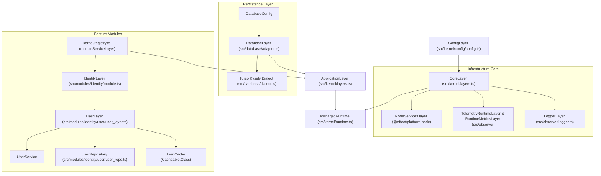
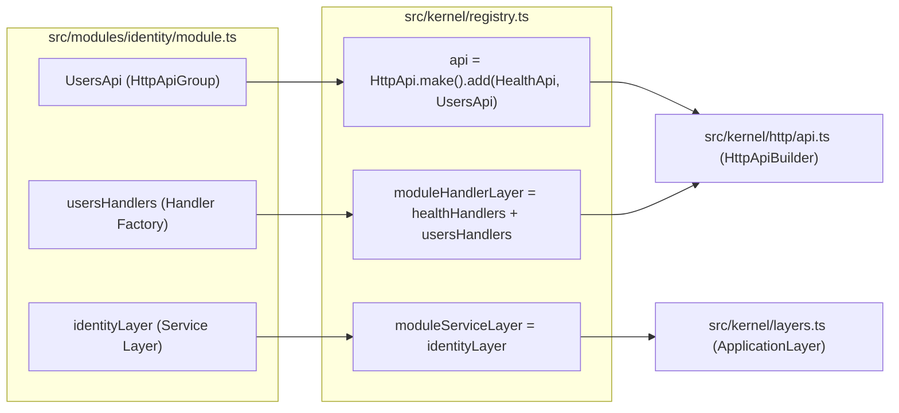
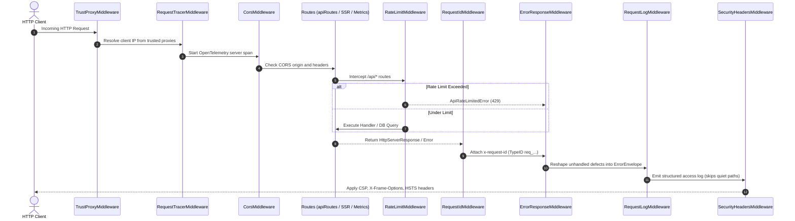

# Architecture

## Runtime composition

Edgy is designed as a modular monolith built on Effect v4. The system separates infrastructure concerns into a platform core layer and domain features into self-contained modules.

`kernel/layers.ts` composes two primary layers:
- `CoreLayer` provides Node platform services, parsed configuration (`AppConfig`), structured logging (`LoggerLayer`), and OpenTelemetry tracing/metrics (`TelemetryRuntimeLayer`, `RuntimeMetricsLayer`).
- `ApplicationLayer` provides domain feature services by layering `moduleServiceLayer` over `DatabaseLayer`. The serve command wraps this layer around both automatic migrations and the HTTP server scope, allowing database connections to be shared safely.

`kernel/runtime.ts` manages a singleton `ManagedRuntime` constructed from `ApplicationLayer` and `CoreLayer`. It controls application lifecycle and disposal (`applicationContext()`, `disposeUserRuntime()`). Start server functions utilize this runtime and bridge request-scoped services via Node's `AsyncLocalStorage`.

## Module registry pattern

Feature modules are self-contained packages under `src/modules/<name>/`. Each module exports its domain routes, handlers, and service layer via a single `module.ts` barrel. `src/kernel/registry.ts` is the single integration file for the entire application:

`kernel/registry.ts` wires the application without touching the kernel core:
1. `api`: Builds the root `HttpApi` using `.add(HealthApi, UsersApi)` with title, version, and `/api` prefix.
2. `moduleServiceLayer`: Merges all feature service layers using `Layer.mergeAll(...)`. Consumed exclusively by `src/kernel/layers.ts`.
3. `moduleHandlerLayer`: Merges all feature handler factories for a given `HttpApi` instance. Consumed exclusively by `src/kernel/http/api.ts`.

## HTTP middleware and request lifecycle

The HTTP pipeline uses a strict middleware composition order defined centrally in `src/kernel/http/stack.ts`. This single definition prevents middleware drift between production serving and development forwarding.

1. `trustProxyMiddleware` (`src/middleware/trust-proxy.ts`): Evaluates `TRUST_PROXY` configuration to safely determine client IP from `X-Forwarded-For` or socket address.
2. `requestTracerMiddleware` (`src/middleware/tracer.ts`): Binds trace context and initiates an OpenTelemetry request span.
3. `corsMiddleware` (`src/middleware/cors.ts`): Emits CORS headers based on `CORS_ENABLED` and `CORS_ALLOWED_ORIGINS`.
4. Routes (`src/kernel/http/api.ts` & `src/kernel/renderer.ts`): Dispatches requests to API endpoints, metrics endpoint, or SSR page router. API routes are wrapped in `rateLimitMiddleware`.
5. `requestIdMiddleware` (`src/middleware/request-id.ts`): Generates a unique TypeID (`req_...`) for every request and sets `x-request-id`.
6. `errorResponseMiddleware` (`src/middleware/error-response.ts`): Intercepts all failures under `/api/*` and normalizes them into the standard `ErrorEnvelope`.
7. `requestLogMiddleware` (`src/middleware/request-log.ts`): Emits structured request logs while suppressing noise from quiet paths (`/.well-known/`, `/favicon`, `/assets/`, `/metrics`).
8. `securityHeadersMiddleware` (`src/middleware/security-headers.ts`): Adds standard security headers. SSR routes supply their own nonce-based CSP (`script-src 'self' 'nonce-...'`).

## Persistence boundary

Persistence utilizes Kysely over SQLite via a unified custom dialect in `src/database/dialect.ts`. The transport is determined strictly by `DATABASE_URL`:
- **Local File (`file:` URI or bare path)**: Uses `@tursodatabase/database` with `experimental: ['multiprocess_wal']`. Multi-process WAL allows concurrent read/write operations across OS processes on the same host (e.g., serve worker, migration CLI, healthcheck probe).
- **Remote Database (`libsql://`, `turso://`, `https://`, `http://`)**: Uses `@tursodatabase/serverless` over HTTP with mandatory `DATABASE_TOKEN`. Every query is bounded by a 5-second timeout, and connection acquisition issues a fast `SELECT 1` pre-flight check.
- **Transactions**: Single-stream execution guarantees connection isolation without custom locking. `insertId` is reported exclusively for `INSERT` statements across both engines.
- **Migrations**: `src/database/migrator.ts` encapsulates the Kysely `Migrator` in Effect's error channel, mapping failure details to `DatabaseError`.

## Cache and rate limiting

- **Cache Subsystem (`src/kernel/cache.ts`)**: Lookups use `Cacheable.Class`. By default, entries reside in a bounded in-memory LRU cache with concurrent lookup deduplication. Enabling `REDIS_ENABLE=true` switches to a shared Redis store (`PersistedCache`, Redis DB 1) with graceful fallback to un-cached database reads upon Redis disruption.
- **Rate Limiting (`src/middleware/rate-limit.ts`)**: Employs a token-bucket algorithm rather than a fixed window. Tokens refill continuously (`refillRateMillis = window / limit`). Counters persist to the `rate_limits` table in SQLite by default, or to Redis (DB 2) when enabled. A database or cache outage causes the rate limiter to fail closed with a `503 DATABASE_ERROR`.

## SSR and hydration architecture

- **Rendering pipeline**: The Effect listener forwards page requests to TanStack Start's `fetch` handler. In production `src/kernel/renderer.ts` imports the built server bundle and calls its default `fetch(request)`; in `vpr dev` Start's dev middleware renders pages inside Vite. Start owns the document shell, streaming, and hydration; the Effect server keeps `/api/*`, metrics, middleware, and static assets.
- **Script Nonce Hardening**: `src/kernel/csp_nonce.ts` mints one TypeID nonce per process and shares it with the router factory (via `globalThis`) and the renderer; the router factory stamps it onto streamed scripts through `ssr.nonce`, and the renderer issues the CSP header (`script-src 'self' 'nonce-...' 'strict-dynamic'`).
- **Server functions**: Page data crosses the client boundary only through `createServerFn` (`src/modules/identity/user/user_fns.ts` wraps `user.server.ts`). Handlers resolve `UserService` through the request-scoped AsyncLocalStorage (`user_context.ts`) and read `nocache` from `getRequest()`. `/api/*` remains the public HTTP contract; a server function is an internal RPC endpoint, not an API.
- **The x-cache bridge**: `setResponseHeader` inside a server function does not reach the HTML response. The handler records the cache verdict on the request-scoped page meta (`src/kernel/page_meta.ts`), and the Start request middleware in `src/start.ts` copies it onto the outgoing HTML response.
- **Zero-Runtime CSS**: Page styles in `src/resources/styles/` are authored with StyleX and extracted to static CSS bundles at build time. `sx` (`src/resources/styles/props.ts`) maps style compositions to a `className` prop.
- **Route tree generation**: The Start plugin's router generator scans `src/routes` and writes the gitignored `src/routes.gen.ts` when its computed content changes. Both `router.routesDirectory` and `router.generatedRouteTree` resolve against `srcDirectory`; a clean checkout has no declaration until `vp dev` or `vp build` runs, so CI builds before lint and typecheck.

Decision record (2026-10-27, from `archive/plan-20261027_0605.md`): **TanStack Start renders pages inside the Effect server; Effect remains the only listener.** Start owns the document shell, streaming, hydration, and the generated route tree; the Effect listener forwards page requests to Start's `fetch`. Rejected: the manual Router recipe with `entry-client`/`entry-server` — it adds a second server the listener would have to duplicate. Rejected: Nitro — it replaces the listener this repository's middleware stack is built around. **Page data moves to `createServerFn`; `/api/*` stays the public contract.** Loaders call server functions; handlers call `UserService` through the existing runtime. Rejected: keeping an `import.meta.env.SSR` branch in shared modules (preserves the old stack's shape), and SSR-side HTTP calls to `/api` (rendering would depend on the listener calling itself).

## Process lifecycle and graceful shutdown

- Positional CLI parsing in `src/command/root.ts` selects the execution runtime. The `serve` command bypasses `runMain` to ensure async finalizers run reliably during termination.
- `src/kernel/graceful.ts` registers signal handlers for `SIGINT` and `SIGTERM`. Shutdown proceeds in strict order:
  1. Stop accepting new HTTP connections and drain in-flight requests (20s timeout).
  2. Flush and close database connections (`Database connection closed`).
  3. Disconnect Redis stores and flush logs.
  4. Emit `Application terminated` and exit `0`. A second signal forces immediate exit with status `128 + signum`.
