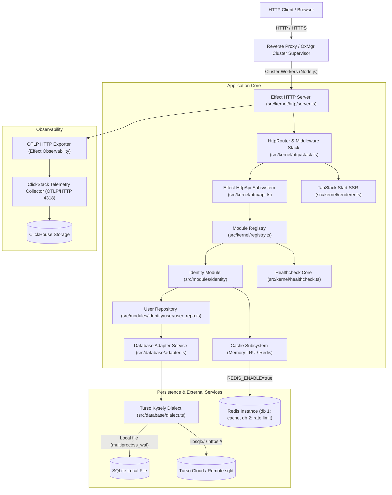

# Repository shape

## Stack

Edgy is a modular TypeScript ESM application running on Node.js 24.22 or newer. The runtime and HTTP composition use `effect` and `@effect/platform-node`. Persistence is managed by Kysely over SQLite through Turso's drivers: `@tursodatabase/database` for local files with multiprocess WAL support, and `@tursodatabase/serverless` over HTTP for remote Turso databases. Frontend pages are server-rendered React 19 components through TanStack Start (`@tanstack/react-start`, `@tanstack/react-router`) with build-time CSS extraction via StyleX. Builds and testing run through Vite and `vite-plus` (`vp`/`vpr`), with standalone deployment bundling and optional multi-core process clustering through OxMgr (`oxfile.toml`).

## Source layout

| Path                               | Responsibility                                                                             |
| ---------------------------------- | ------------------------------------------------------------------------------------------ |
| `src/main.ts`, `src/command/`      | Process entry point, CLI command tree (`serve`, `healthcheck`, `migrate:*`, `generate:config`). |
| `src/kernel/layers.ts`             | Dependency injection composition roots (`CoreLayer`, `ApplicationLayer`).                  |
| `src/kernel/registry.ts`           | Single file where feature modules wire their HttpApi groups, handlers, and service layers. |
| `src/kernel/runtime.ts`            | `ManagedRuntime` lifecycle ownership and disposal for SSR and development adapters.        |
| `src/kernel/http/`                 | HTTP server, middleware stack, envelope factories (`envelope.ts`), responder (`respond.ts`). |
| `src/kernel/config/`               | Validated typed configuration definitions for app, server, database, redis, logging, etc. |
| `src/modules/`                     | Self-contained domain modules (`identity/user`) containing route, handler, service, repo.  |
| `src/database/`                    | Turso Kysely dialect (`dialect.ts`), adapter (`adapter.ts`), migrator, schema, seeders.   |
| `src/middleware/`, `src/observer/` | HTTP middlewares (CORS, error reshaping, rate limit, request-id, log) and OpenTelemetry.  |
| `src/routes/`, `src/resources/`    | TanStack Start file routes, shared components, and StyleX styling definitions.            |
| `src/builder/`                     | Vite plugins, standalone dependency inlining, leak verification, and oxfile generation.   |
| `tests/`                           | Integration tests, API tests, and test fixtures; unit tests sit beside their source files. |

## Commands

| Command                 | Purpose                                                                             |
| ----------------------- | ----------------------------------------------------------------------------------- |
| `vpr dev`               | Start the Vite development server with HMR and live server reloading.              |
| `vpr build`             | Build the production server and browser bundles to `dist/`.                         |
| `vpr build:standalone`  | Build a minified standalone bundle with all dependencies inlined into `dist/entry.js`.|
| `vpr preview`           | Preview the built production application locally.                                  |
| `vpr start`             | Start the built server with production environment defaults (`node dist/entry.js serve`). |
| `vpr start:cluster`     | Build standalone and run with OxMgr cluster runtime (`oxmgr runtime ./oxfile.toml`).|
| `vpr test`              | Run the complete unit and integration test suite via Vitest.                       |
| `vpr typecheck`         | Validate TypeScript project references without emitting output (`tsc -b --noEmit`). |
| `vpr check`             | Verify formatting (`vp fmt --check`) and run linter (`vp lint`).                   |
| `vpr format`            | Format all matched files in place (`vp fmt --write .`).                             |
| `vpr lint`              | Fix lint issues across the codebase (`vp lint --fix .`).                            |
| `vpr coverage`          | Run unit and integration tests with coverage reporting.                             |
| `vpr app <command>`     | Execute the application CLI directly from source (`node src/main.ts ...`).         |
| `vpr compose:up`        | Spin up the ClickStack observability stack, Redis, cAdvisor, and app in Docker.     |
| `vpr compose:down`      | Shut down the Docker Compose stack.                                                 |

All commands run through `vpr <script>`; `vpr app <command>` invokes the application CLI from source.

## Deployment and runtime contract

1. **Standalone bundle**: `vpr build:standalone` emits a single executable script `dist/entry.js` with zero bare node_modules dependencies. The Turso native engine binding (`@tursodatabase/database-<platform>`) is copied into `dist/node_modules/` for the target platform.
2. **Container builds**: A container build passes `--build-arg DISTROLESS_TAG=debug-nonroot`. The bundle's shebang is `#!/busybox/env node` (via `ENV_BINARY_PATH` in `Dockerfile`), requiring the `debug` distroless variant with `/busybox`.
3. **Process clustering (OxMgr)**: A standalone build writes `dist/oxfile.toml` by default, configured for Node's `cluster` module (`cluster_mode = true`, `cluster_instances = 4`). Database migrations must be run as a separate step (`vpr app migrate:up` or `node entry.js migrate:up`) prior to launching clustered workers to avoid concurrent migration race conditions.
