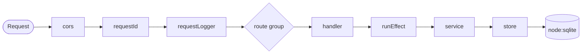

# Edgy

[](https://nodejs.org)
[](tsconfig.json)
[](package.json)

A small, opinionated reference server that shows how to wire [Effect](https://effect.website) (typed
errors, dependency injection, structured logging) to [H3](https://h3.dev) (routing, middleware) and
[Kysely](https://kysely.dev) on top of Node's built-in `node:sqlite`.

The project ships its own Rolldown-based build pipeline — a lean take on Nitro — that emits a
standalone server bundle with no `node_modules` at runtime, and can optionally compile a single
executable using Node's [Single Executable Applications](https://nodejs.org/api/single-executable-applications.html) API.

## Features

- **Typed end to end** — handlers return `Effect<A, AppError, AppEnv>`; failures map to HTTP status codes by tag.
- **Plugin-based routing** — route groups and middleware are H3 plugins, composed in one place.
- **Built-in middleware** — request ID (TypeID), structured request logger, and configurable CORS.
- **Zero native dependencies** — SQLite via `node:sqlite`, so the bundle needs no compiled addon.
- **Configurable build** — code splitting per dependency, optional minify/obfuscation, all off or on by flags.
- **Optional single executable** — `pnpm compile` produces one self-contained binary.

## Requirements

- **Node.js >= 24.21** — required for the stable `node:sqlite` and native TypeScript stripping.
- **pnpm 12** — declared via `devEngines`; `npx` is intentionally rejected.

## Getting started

```bash
pnpm install
pnpm app migrate      # create the users table
pnpm app seed         # insert sample rows (idempotent)
pnpm app serve        # http://localhost:3000
```

Verify it is up:

```bash
curl http://localhost:3000/
# {"message":"All is well"}

curl http://localhost:3000/users
# [{"id":1,"email":"ada@example.com","name":"Ada Lovelace"}, ...]
```

## CLI

The entry point is `src/main.ts`, run directly by Node (no build step in development).

```bash
pnpm app <command> [flags]
```

See the [CLI Documentation](./docs/commandline.md) for the details.

## Configuration

All configuration is read from environment variables through Effect's `Config`, validated at startup.

| Variable             | Default                    | Description                                                            |
| -------------------- | -------------------------- | ---------------------------------------------------------------------- |
| `DATABASE_PATH`      | `./storage/data/edgy.db`   | SQLite file path; parent directories are created automatically          |
| `HOST`               | `0.0.0.0`                  | Bind address                                                           |
| `PORT`               | `3000`                     | Bind port                                                              |
| `LOG_LEVEL`          | `Info`                     | `All` \| `Fatal` \| `Error` \| `Warn` \| `Info` \| `Debug` \| `Trace` \| `None` (**case-sensitive**) |
| `CORS_ORIGINS`       | `*`                        | `*` or a comma-separated allowlist                                     |
| `CORS_METHODS`       | `*`                        | `*` or a comma-separated list                                          |
| `CORS_ALLOW_HEADERS` | `*`                        | `*` or a comma-separated list                                          |
| `CORS_CREDENTIALS`   | `false`                    | Send `access-control-allow-credentials`                                |
| `CORS_MAX_AGE`       | `86400`                    | Preflight cache seconds; `false` or `0` omits the header               |

> [!WARNING]
> `CORS_CREDENTIALS=true` requires an explicit `CORS_ORIGINS` allowlist. A wildcard origin is
> invalid for credentialed requests, so the process fails fast at startup instead of sending a
> header browsers will reject.

```bash
CORS_ORIGINS="https://app.example.com,https://admin.example.com" \
CORS_CREDENTIALS=true \
LOG_LEVEL=Warn \
PORT=8080 \
pnpm app serve
```

## API

| Method | Path                          | Description                        |
| ------ | ----------------------------- | ---------------------------------- |
| `GET`  | `/`                           | Health check                       |
| `GET`  | `/users`                      | List users                         |
| `GET`  | `/users/:id`                  | Fetch one user                     |
| `POST` | `/users`                      | Create a user from a JSON body     |
| `GET`  | `/.well-known/security.txt`   | Contact metadata (RFC 9116 style)  |

Every response carries an `x-request-id` header. Send your own to continue an upstream trace:

```bash
curl -H 'x-request-id: req_from_gateway' http://localhost:3000/users
```

> [!NOTE]
> Error responses include CORS headers too — H3 merges `event.res.errHeaders` into error responses,
> so the request ID and CORS survive on `4xx` and `5xx` alike.

## Project structure

```
src/
  main.ts            # CLI entry (Node strips types; no build needed)
  app.ts             # composition root: global plugins + route groups
  server.ts          # HTTP server wiring (h3 serve + Effect lifecycle)
  config.ts          # validated, injectable configuration
  runtime.ts         # ManagedRuntime + layers (config, db, cache, logging)
  routes/            # plugin-based route groups
  middleware/        # request ID, request logger, CORS, cache-control
  handler/           # H3 event handlers
  service/           # business logic (Effect programs)
  stores/            # Kysely queries
  database/          # node:sqlite dialect, migrator, seeders
builder/             # self-contained build pipeline (see below)
```

### Request flow



Handlers stay thin: they validate input with Effect Schema and delegate to `runEffect`, which runs the
program on the app runtime, records metrics, opens a trace span, and maps typed failures
(`ValidationError` → 400, `NotFound` → 404, `DatabaseError` → 500) to JSON responses.

## Building

The `builder/` directory is a small Rolldown pipeline, deliberately independent of `src/`. It bundles
the server, keeps native packages external, traces them into the output, and emits a minimal
`package.json` so the result runs without the project's own `node_modules`.

```bash
pnpm build       # -> dist/server  (ESM bundle + chunks)
pnpm compile     # -> dist/server + dist/edgy  (single executable, experimental)
```

Flags apply to both commands:

```bash
pnpm build --no-splitting          # one self-contained index.mjs
pnpm build --minify                # minify with Rolldown's oxc minifier
pnpm build --obfuscate             # obfuscate chunks (javascript-obfuscator)
pnpm build --minify --obfuscate    # both
```

Run the bundle anywhere, with no `node_modules` present:

```bash
node dist/server/index.mjs serve
```

### Configuration file

`builder/builder.config.ts` is optional; every field has a sensible default. Common options:

| Option          | Default                     | Description                                                     |
| --------------- | --------------------------- | --------------------------------------------------------------- |
| `entry`         | `src/main.ts`               | Server entry point                                              |
| `outDir`        | `dist`                      | Build output root                                               |
| `splitting`     | `true`                      | Split shared code into chunks                                   |
| `splitPackages` | `true`                      | One chunk per dependency instead of a single `vendor` chunk     |
| `chunkGroups`   | `[]`                        | Extra chunk groups (e.g. group `effect` separately)             |
| `minify`        | `false`                     | Minify the bundles                                              |
| `obfuscate`     | `false`                     | Obfuscate the bundles                                           |
| `external`      | native packages             | Packages kept external and traced into the output               |
| `seaConfig`     | `{ enable: false }`         | Single executable options (see below)                           |
| `rolldownOptions` | `{}`                      | Escape hatch, deep-merged over the builder's Rolldown config    |

> [!TIP]
> `rolldownOptions` is merged (arrays concatenate), so extra plugins append instead of replacing the
> builder's externals plugin:
>
> ```ts
> rolldownOptions: {
>   resolve: { alias: { '#': './src' } },
>   output: { comments: false }
> }
> ```

### Single executable

`pnpm compile` bundles the server as one CommonJS file, generates a preparation blob with
`node --experimental-sea-config`, and injects it into a copy of the running `node` binary using
[postject](https://github.com/nodejs/postject).

```bash
pnpm compile
./dist/edgy serve
```

The compiler is driven by `seaConfig` in `builder.config.ts`:

```ts
seaConfig: {
  enable: false,                      // set by the `compile` command
  fileName: 'edgy',                   // -> dist/edgy (.exe on Windows)
  disableExperimentalSEAWarning: true,
  useCodeCache: false,
  useSnapshot: false,
  execArgv: [],
  execArgvExtension: 'env',           // 'none' | 'env' | 'cli'
  assets: {},                         // key -> path, readable via node:sea
  target: undefined                   // e.g. 'linux-x64'; defaults to the host
}
```

> [!IMPORTANT]
> Node marks Single Executable Applications as **experimental** (stability 1.1). The generated
> binary:
>
> - embeds the Node runtime, so expect **~120 MB**;
> - **cannot be cross-compiled** — it only runs on the platform that built it;
> - is supported on Windows, macOS (arm64) and Linux (except Alpine and s390x).
>
> On macOS the compiler strips and re-signs the binary ad-hoc around the injection step; if there are
> external native addons, embed them through `seaConfig.assets` and load them with `process.dlopen`.
> This project uses `node:sqlite`, so the output has no external dependencies.

## Development

```bash
pnpm watch        # server with --watch
pnpm typecheck    # tsc --noEmit
pnpm check        # oxfmt --check + oxlint
pnpm format       # oxfmt --write .
```

## References

- Effect — [getting started](https://effect.website/docs/v4/getting-started) · [Config](https://effect.website/docs/v4/api/effect/Config) · [Logger](https://effect.website/docs/v4/api/effect/Logger) · [Schema](https://effect.website/docs/v4/api/effect/Schema) · [CLI](https://effect.website/docs/v4/api/effect/cli/Command)
- H3 — [guide](https://h3.dev/guide/api/h3) · [event](https://h3.dev/guide/api/h3event) · [middleware](https://h3.dev/guide/basics/middleware) · [plugins](https://h3.dev/guide/advanced/plugins) · [utilities](https://h3.dev/utils)
- Kysely — [documentation](https://kysely.dev)
- Node.js — [`node:sqlite`](https://nodejs.org/api/sqlite.html) · [single executable applications](https://nodejs.org/api/single-executable-applications.html)
