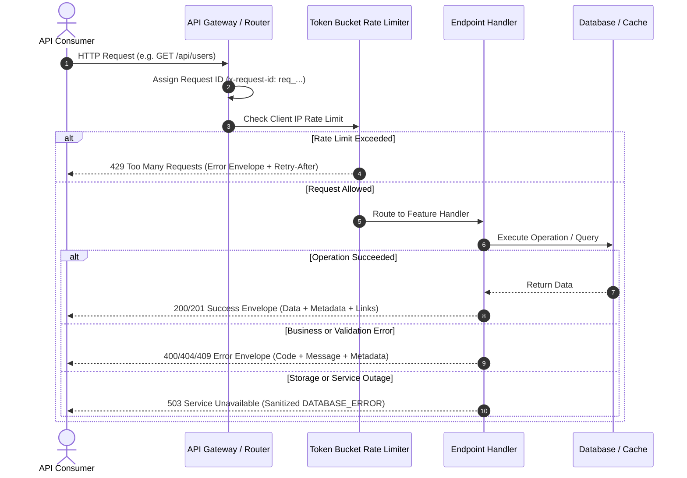

# API Endpoints

The server exposes a typed REST API under `/api` alongside interactive API documentation and health probes.

| Method   | Path                | Behavior                                                              |
| -------- | ------------------- | --------------------------------------------------------------------- |
| `GET`    | `/api/health`       | Checks whether dependencies answer readiness queries (fail-closed).   |
| `GET`    | `/api/users`        | Returns a cursor-paginated list of user records.                      |
| `GET`    | `/api/users/:id`    | Returns a single user by ID (`user_...`), or `404`.                   |
| `POST`   | `/api/users`        | Creates a user; returns `201`, or `409` on duplicate email.           |
| `PATCH`  | `/api/users/:id`    | Merges partial fields into an existing user, or `404`.                |
| `DELETE` | `/api/users/:id`    | Deletes a user by ID; returns `200` with empty body, or `404`.        |
| `GET`    | `/api-docs`         | Interactive Scalar API documentation (active when enabled).           |
| `GET`    | `/api/openapi.json` | OpenAPI 3.1 specification for the API (active when enabled).          |
| `GET`    | `/metrics`          | Prometheus metrics scrape endpoint (active when metrics are enabled). |

Every GET endpoint supports `HEAD` requests, returning identical headers and status codes without a response body.

## Request and response lifecycle



## Response envelope

Every API response under `/api/*` (with the exception of `/api/health`) conforms to a unified JSON response envelope.

### Success envelope

```json
{
  "status": "success",
  "data": {
    "id": "user_01m5k7w3p8fvx9r2c4t6y0hq1d",
    "email": "ada@example.com",
    "name": "Ada Lovelace"
  },
  "metadata": {
    "status_code": 200,
    "request_id": "req_01m5k7w3p8fvx9r2c4t6y0hq1d",
    "trace_id": "trc_01m5k7w3p8fvx9r2c4t6y0hq1d",
    "cache": "hit"
  }
}
```

- `metadata.status_code`: Matches the HTTP response status code.
- `metadata.request_id`: Correlates with the `x-request-id` response header for tracing and audit logs.
- `metadata.trace_id`: Present when OpenTelemetry tracing is active.
- `metadata.cache`: Emitted on cached lookups (`hit`, `miss`, `bypass`, or `disabled`). Pass `?nocache=1` to bypass the cache — a debugging affordance that production ignores.

### Error envelope

```json
{
  "status": "error",
  "message": "User not found",
  "error": {
    "code": "USER_NOT_FOUND",
    "retryable": false,
    "details": {
      "id": "user_01m5k7w3p8fvx9r2c4t6y0hq1d"
    }
  },
  "metadata": {
    "status_code": 404,
    "request_id": "req_01m5k7w3p8fvx9r2c4t6y0hq1d"
  }
}
```

- `message`: Human-readable summary of the error.
- `error.code`: Stable uppercase machine-readable error token (e.g. `USER_NOT_FOUND`, `VALIDATION_FAILED`).
- `error.retryable`: Boolean indicating whether retrying the exact request without changes might succeed.
- `error.details`: Structured diagnostic information when applicable (e.g., validation path failures).

## Pagination

Collection endpoints such as `GET /api/users` use cursor-based pagination:

| Query parameter | Default | Description                                                      |
| --------------- | ------- | ---------------------------------------------------------------- |
| `limit`         | `20`    | Number of records per page (minimum `1`, maximum `100`).         |
| `cursor`        | `null`  | Opaque token from a preceding response's `metadata.next_cursor`. |
| `sort_by`       | `id`    | Field to sort by (`id` or `created_at`).                         |
| `sort_order`    | `asc`   | Sort direction (`asc` or `desc`).                                |

Paginated responses embed pagination state in `metadata` and provide navigation URLs in `links`:

```json
{
  "status": "success",
  "data": [...],
  "metadata": {
    "status_code": 200,
    "request_id": "req_...",
    "limit": 20,
    "has_more": true,
    "next_cursor": "eyJzb3J0VmFsdWUiOiJ1c2VyXzAxLi4ifQ"
  },
  "links": {
    "self": "/api/users?limit=20",
    "first": "/api/users?limit=20",
    "next": "/api/users?limit=20&cursor=eyJzb3J0VmFsdWUiOiJ1c2VyXzAxLi4ifQ"
  }
}
```

When `metadata.has_more` is `false`, `next_cursor` and `links.next` are `null`. Cursors are bound to the specific sort criteria under which they were generated; an invalid or corrupted cursor returns `400` with code `INVALID_CURSOR`.

## Health and readiness

`GET /api/health` serves as a machine-level readiness probe for load balancers and container orchestrators:

```json
{
  "status": "ok",
  "details": {
    "database": {
      "status": "up",
      "timestamp": "2026-10-26T17:00:00.000Z"
    }
  }
}
```

- If all registered dependencies are operational within the 2-second timeout, it returns `200` with `status: "ok"`.
- If any component is down or times out, it fails closed with `503` and `status: "unhealthy"`. The unhealthy body names the failing dependency with a stable `error: "unavailable"` code; the raw failure detail goes to the server logs, not the response.
- This probe does not use the standard API response envelope and is completely exempt from rate limiting.

## Users resource

- `GET /api/users`: Returns a paginated list of user records.
- `GET /api/users/:id`: Looks up a user by their TypeID (`user_...`). Accepts `?nocache=1` to force cache refresh (debugging affordance; ignored in production).
- `POST /api/users`: Creates a user with initial role `10` (SUBSCRIBER). Payload requires `email` (valid email, max 254 chars), optional `name` (max 200 chars), and optional `avatar_url` (absolute URL, max 2048 chars).
- `PATCH /api/users/:id`: Updates user fields. Absent fields remain untouched; sending `null` clears optional fields. Duplicate emails trigger `409 EMAIL_CONFLICT`.
- `DELETE /api/users/:id`: Hard-deletes the user record and invalidates cached data.

## Standard error codes

| Error code                     | Status | Meaning                                                             |
| ------------------------------ | ------ | ------------------------------------------------------------------- |
| `VALIDATION_FAILED`            | `400`  | Request body or query parameters failed schema validation.          |
| `INVALID_CURSOR`               | `400`  | Pagination cursor was malformed or incompatible with selected sort. |
| `NOT_FOUND`                    | `404`  | Requested API path or HTTP method is not registered.                |
| `USER_NOT_FOUND`               | `404`  | Specified user ID does not match an existing record.                |
| `EMAIL_CONFLICT`               | `409`  | Submitted email address is already registered to another user.      |
| `RATE_LIMITED`                 | `429`  | Request rate exceeded client quota.                                 |
| `INTERNAL_ERROR`               | `500`  | Unexpected server defect occurred.                                  |
| `DATABASE_ERROR`               | `503`  | Database was unreachable or timed out.                              |
| `RATE_LIMIT_STORE_UNAVAILABLE` | `503`  | Rate limiter storage was unreachable or timed out.                  |

## Rate limiting

API endpoints enforce a token-bucket rate limiter identified by client IP. The bucket refills continuously according to the configured window and quota:

- When quota is exceeded, responses return status `429 Too Many Requests`.
- Standard headers `Retry-After`, `RateLimit-Limit`, `RateLimit-Remaining`, and `RateLimit-Reset` indicate when more capacity will be available.
- Response `metadata.rate_limit` carries `{ limit, remaining, reset }`.
- Storage failures fail closed with the error envelope (`503 RATE_LIMIT_STORE_UNAVAILABLE`, `retryable: true`) to protect system stability.

## Interactive documentation

When enabled (`API_DOCS_ENABLED=true`):

- `/api-docs`: Interactive documentation interface powered by Scalar.
- `/api/openapi.json`: OpenAPI 3.1 specification describing schemas, parameters, and responses.

---

Go to [documentation index](./index.md)
