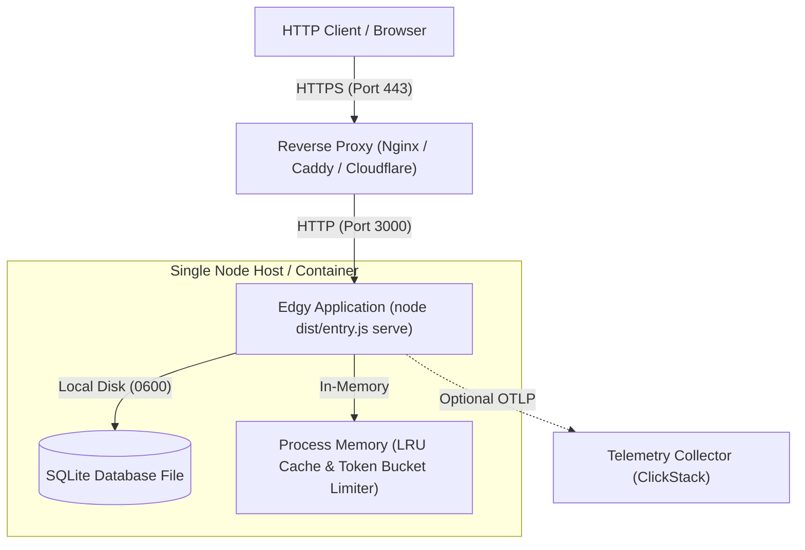
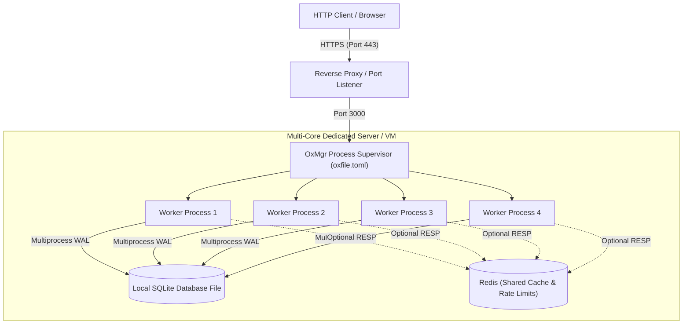
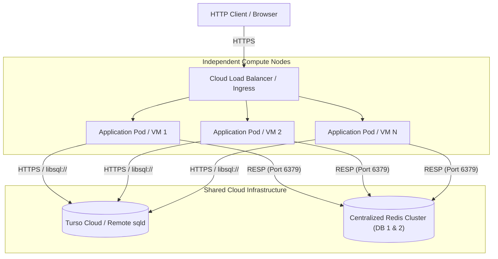

# Deployment

Edgy is deployed as a standalone Node.js process or container image with zero external runtime dependencies.

## Deployment topologies

The application supports two distinct operational modes based on workload, resource scale, and architecture: **Single node mode** and **Cluster mode**.

### Single node mode

A lightweight deployment pattern running one application process behind a reverse proxy. Best suited for single-container setups, VPS hosting, staging environments, and moderate traffic.



In single node mode:

- **Execution**: Run directly with `node dist/entry.js serve` (or `vpr start`).
- **Persistence**: Employs a local SQLite file (`storage/data/app.db`) through Turso's embedded engine with multi-process WAL.
- **Cache & Throttling**: User cache lookups and rate-limiting buckets reside in process memory without requiring external Redis infrastructure.
- **Maintenance**: Migrations can be applied automatically at boot via `--auto-migrate` or as a release step via `migrate:up`.

### Cluster mode

A high-throughput deployment pattern that distributes workload across multiple processes or instances to maximize CPU utilization and provide redundancy.

#### 1. Local multi-worker cluster (OxMgr)

Supervises multiple Node.js worker processes across available CPU cores on a single physical server or virtual machine using Node's native `cluster` module.



- **Execution**: Start the clustered workers using `vpr start:cluster` (or `oxmgr runtime ./oxfile.toml`).
- **Persistence**: All worker processes safely read and write to the same local SQLite database file via multi-process WAL mode (`multiprocess_wal`).
- **State Coordination**: To share rate limits and cached entries seamlessly across workers, set `REDIS_ENABLE=true` pointing to a local or remote Redis instance.
- **Migration Rule**: Always run `node dist/entry.js migrate:up` before starting the cluster. Clustered workers must never run with `--auto-migrate` to prevent database lock contention during boot.

#### 2. Distributed multi-node cluster

Scales horizontally across multiple separate host machines, Kubernetes pods, or container instances behind a global or cloud load balancer.



- **Execution**: Each compute node runs independently via container orchestration or cloud runners.
- **Persistence**: Nodes connect to a shared remote Turso database over HTTP/libSQL (`DATABASE_URL=libsql://...` with `DATABASE_TOKEN`).
- **Distributed State**: Centralized Redis (`REDIS_ENABLE=true`) synchronizes token-bucket rate limits and cached records across all active nodes.
- **Health Probes**: Each node answers readiness checks at `/api/health`, failing closed if either Turso or Redis fails to respond.

## Build artifacts

```bash
vpr build               # standard production build
vpr build:standalone    # standalone bundle with all dependencies inlined
```

- `vpr build`: Compiles server entry points and client browser bundles into `dist/`.
- `vpr build:standalone`: Inlines all dependencies into a single executable script (`dist/entry.js`). The target platform's native Turso engine binding is copied into `dist/node_modules/@tursodatabase/`. Copying the `dist/` directory produces a self-contained deployable unit.

To execute the built server:

```bash
node dist/entry.js serve
```

## Process clustering with OxMgr

Standalone builds automatically emit `dist/oxfile.toml`, configured for multi-worker process clustering using Node's `cluster` module.

To run the clustered runtime:

```bash
vpr start:cluster
```

> [!IMPORTANT]
> Run database migrations (`node dist/entry.js migrate:up`) as a separate step before starting cluster mode. Clustered workers run as independent OS processes and would otherwise race to migrate the database concurrently.

## Container deployment

The application Dockerfile builds a distroless container image:

```bash
vpr docker:build
```

- The container executes as a non-root user.
- The build uses `--build-arg DISTROLESS_TAG=debug-nonroot` to provide `/busybox/env` for executing the Node runtime.
- The container healthcheck runs `entry.js healthcheck`, verifying database readiness every 20 seconds.
- Storage volumes should mount to `/app/storage` for persistent local SQLite databases and log sinks.

## Docker Compose development stack

To spin up the complete local environment including observability and Redis:

```bash
vpr compose:up     # start services in background
vpr compose:down   # stop and remove containers
```

Services in the compose stack:

- **Application (`app`)**: Built from the project Dockerfile with a 256 MB memory limit.
- **ClickStack (`clickstack`)**: Combined OpenTelemetry collector, ClickHouse analytics store, and telemetry UI answering at `http://localhost:8080`.
- **Redis (`redis`)**: In-memory store for distributed caching (DB 1) and rate limits (DB 2).
- **cAdvisor (`cadvisor`)**: Gathers container-level CPU and memory metrics.
- **Mailpit (`mailpit`)**: Local SMTP server and inbox viewer for development emails.
