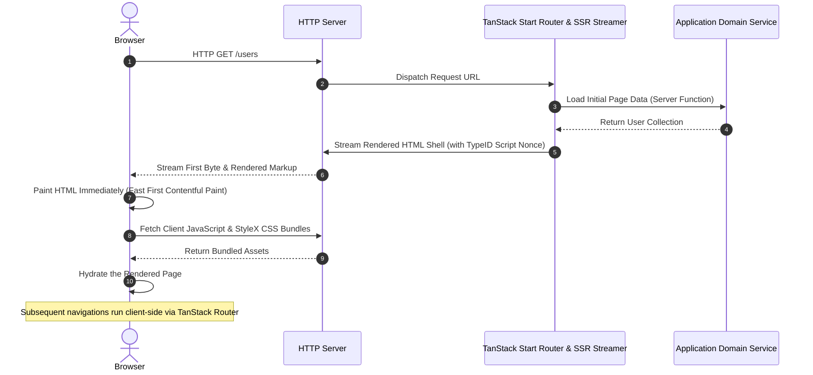

# Development

## Day-to-day commands

All workflow commands run through `vpr`:

```bash
vpr dev                # start Vite development server with HMR and live reload
vpr test               # run all unit and integration test suites
vpr typecheck          # perform strict TypeScript checking without emit
vpr check              # verify formatting and run linter rules
vpr format             # format files across the codebase in place
vpr lint               # fix autofixable linting issues
vpr coverage           # generate test execution coverage reports
vpr build              # create production build
vpr preview            # preview production build locally
```

Execute application CLI commands using `vpr app <command>`.

## Database workflow

Edgy uses SQLite via Turso's embedded engine with multi-process WAL enabled:

```bash
vpr app migrate:status   # inspect applied and pending migrations
vpr app migrate:up       # run pending migrations
vpr app migrate:seed     # insert sample fixture data
```

To automatically apply migrations before starting the dev server, set `DATABASE_AUTO_MIGRATE=true` in `.env.local` or pass `--auto-migrate` to the serve command.

> [!NOTE]
> In-memory databases (`:memory:`) are explicitly disabled because healthcheck probes, migration commands, and server processes run in independent OS processes and require shared access to the file.

## Frontend architecture

The server renders HTML pages using React 19 with TanStack Start's streaming SSR and compile-time CSS extraction powered by StyleX.

### SSR and hydration lifecycle



### File-based routing

Route components live under `src/routes/`:

| Directory / File                       | Purpose                                                             |
| -------------------------------------- | ------------------------------------------------------------------- |
| `src/routes/_app/index.tsx`            | Root landing page (links to `/users`).                              |
| `src/routes/_app.tsx`                  | Pathless layout providing the global navigation bar and container.  |
| `src/routes/_app/users.tsx`            | Users section layout wrapper.                                       |
| `src/routes/_app/users/index.tsx`      | Users list page displaying paginated user cards.                    |
| `src/routes/_app/users/$id.tsx`        | Dynamic user detail page rendering user profile information.        |
| `src/routes/_app/$.tsx`                | Catch-all error page for unrecognized URLs.                         |

### Styling with StyleX

Styles are authored as typed TypeScript objects and compiled into zero-runtime CSS:

- Shared design tokens, colors, and utility styles (`fx`) reside in `src/resources/styles/core/`.
- Page-specific styles sit beside their domain in `src/resources/styles/pages/`.
- Components apply styles using the `sx` prop helper:

```tsx
<h2 {...sx(fx.h2, userStyles.detailTitle)}>{user.name}</h2>
```

## Testing

The project uses Vitest for testing:

```bash
vpr test
```

- **Unit tests**: Colocated next to source files (e.g. `*.test.ts`).
- **Integration tests**: Located in `tests/` covering API routes, middleware ordering, and builder plugins.
- **Fixtures**: Shared test databases and mock configurations live in `tests/fixtures/`.

---

Go to [documentation index](./index.md)
